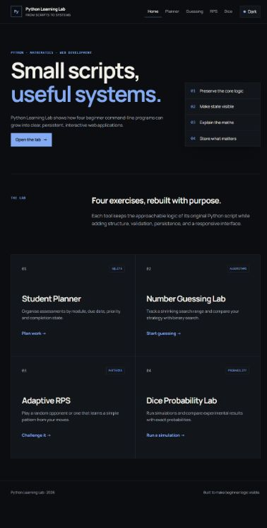
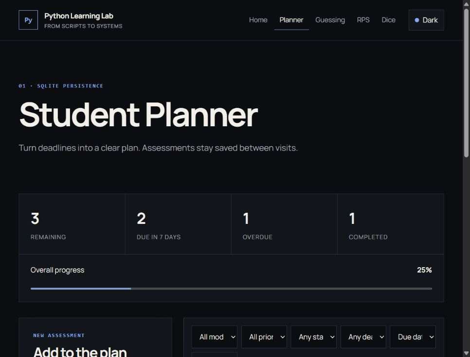
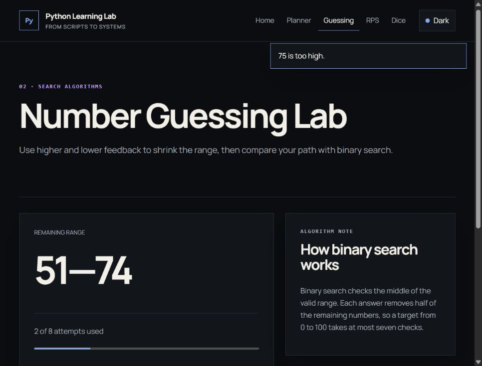
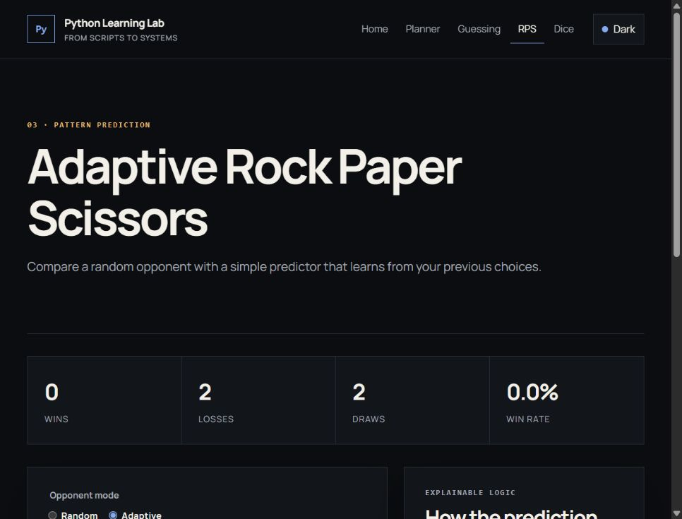
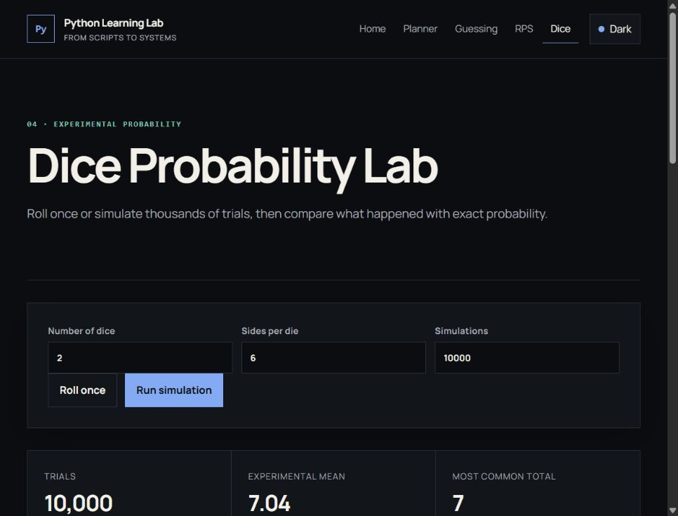

# Python Learning Lab

Python Learning Lab is a Flask web application that expands four beginner command-line exercises into useful interactive tools. It keeps the original ideas visible while adding persistent data, validation, browser interfaces, reusable Python logic, and tests.

The project began as small Python exercises and was later expanded into a web application with assistance from OpenAI Codex. The original CLI scripts remain in `original_cli_projects/` so the progression can be compared honestly.

## Why I expanded the mini projects

The original scripts helped me practise loops, conditionals, functions, lists, random numbers, and input validation. Rebuilding them as one web project gave me a practical way to learn how Flask routes, HTML forms, sessions, SQLite, templates, CSS, and tests fit together.

## Tools

### Student Planner

- Create, view, edit, complete, reopen, and delete assessments.
- Save tasks permanently in SQLite.
- Record a title, description, module, due date, priority, status, and creation date.
- Filter by module, priority, status, and deadline.
- Sort by due date or priority.
- Review overdue, due-soon, completed, remaining, and progress totals.

### Number Guessing Lab

- Choose Easy (12 attempts), Medium (8), or Hard (5).
- Receive higher/lower feedback and see the valid range narrow.
- Keep guess history and attempt totals in a signed Flask session.
- Compare the completed round with every step binary search would take.
- Restart a round without refreshing the application manually.

### Adaptive Rock Paper Scissors

- Play against a random or adaptive opponent.
- Track wins, losses, draws, win rate, and recent moves.
- Use an explainable transition/frequency predictor in adaptive mode.
- Reset the session statistics at any time.
- Describe the predictor honestly as a small pattern detector, not advanced AI.

### Dice Probability Lab

- Roll up to 10 dice with 2–100 sides.
- Run up to 100,000 simulations in Python.
- Compare frequency, experimental probability, exact theoretical probability, and difference for every total.
- Review the mean, most common total, table, and responsive CSS bar chart.
- Learn why experimental results tend toward theoretical probability as trials increase.

## Technology

- Python 3.10+
- Flask 3.1.2
- SQLite through Python's built-in `sqlite3` module
- Jinja templates
- Plain CSS
- Minimal vanilla JavaScript
- Python `unittest`

No React, TypeScript, Tailwind, JavaScript build system, or external chart library is used.

## Folder structure

```text
python-learning-lab/
├── app.py                       # Flask application factory and routes
├── database.py                  # SQLite schema and task operations
├── services/
│   ├── dice_lab.py              # Simulation and exact probability logic
│   ├── guessing_lab.py          # Guessing state and binary search
│   ├── rps_lab.py               # Winner rules and simple prediction
│   └── task_validation.py       # Planner form rules
├── original_cli_projects/       # Preserved beginner scripts
├── templates/                   # Jinja page templates
├── static/
│   ├── css/style.css
│   ├── js/app.js
│   ├── js/theme.js
│   └── fonts/
├── tests/test_learning_lab.py
├── instance/                    # Local SQLite database; ignored by Git
└── requirements.txt
```

## Windows setup

Open the repository folder in VS Code, then open **Terminal → New Terminal**. Use PowerShell for these commands.

Create a virtual environment:

```powershell
py -m venv .venv
```

Install the dependency without activating the environment:

```powershell
.\.venv\Scripts\python.exe -m pip install -r requirements.txt
```

Run the application:

```powershell
.\.venv\Scripts\python.exe -m flask --app app run --debug
```

Open <http://127.0.0.1:5000>. The SQLite database is created automatically at `instance/python_learning_lab.sqlite3` on the first import or run.

Optional virtual-environment activation:

```powershell
.\.venv\Scripts\Activate.ps1
python -m flask --app app run --debug
```

If PowerShell blocks activation, use the earlier command that calls `.venv\Scripts\python.exe` directly. Activation is convenient but not required.

## Tests

```powershell
.\.venv\Scripts\python.exe -m unittest discover -s tests -v
```

The tests cover dice probability calculations, Rock Paper Scissors rules and prediction, guessing range updates and binary search, SQLite CRUD/filter/statistics behavior, database creation, and key application routes.

## Screenshots

### Home and tool index



### Student Planner



### Number Guessing Lab



### Adaptive Rock Paper Scissors



### Dice Probability Lab



## What I learned

- How to move logic out of route functions and into testable Python modules.
- How CRUD operations map to HTML forms and SQLite queries.
- How Flask sessions can hold small game states safely between requests.
- How exact dice distributions can be built by counting combinations.
- How a simple prediction algorithm should be explained without overstating what it can do.
- How accessible labels, focus styles, responsive layouts, and server-side validation support each other.

## Future improvements

- Add CSRF protection before exposing write actions on a public multi-user deployment.
- Add accounts if different students need private planner data.
- Add timezone-aware reminders and calendar export.
- Add optional seeded simulations for reproducible classroom demonstrations.
- Add end-to-end browser tests alongside the current Python tests.

The current application is intended for local learning use. Planner data is stored in one local SQLite database, and game state is stored in the browser session cookie.
